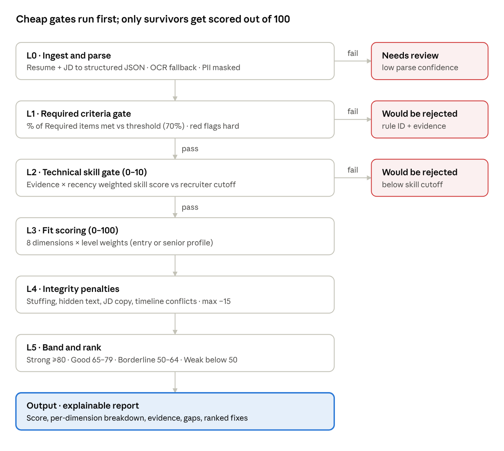

# ATS Engine — PRD (Entry & Senior SWE)

Nov 4, 2026 · Srijan Singh

> Living version (editable, with comments): https://claude.ai/artifact/9s76EvvKtvmg5tvNSk2h2v

## Overview

The engine takes one JD and one resume and returns a 0–100 fit score, a pass/reject decision and the evidence behind both. It runs six layers in order. Cheap binary gates run first, then weighted scoring, then integrity checks and banding.

**Problem.** Keyword-match ATSs reward stuffing and miss real evidence. They also treat a fresher and a staff engineer with one rubric. Candidates can't see why they were filtered out, or what to fix.

**Goals**

- Score fit out of 100 with a per-dimension breakdown and quoted resume evidence for every point awarded or lost.
- Separate "would be auto-rejected" gaps (knockouts) from soft gaps, matching the Required / Preferred model of a typical JD config.
- Use different weight profiles for entry and senior roles.
- Return a ranked list of concrete fixes, each with its estimated point gain, so the candidate knows what to change first.
- Same inputs give the same score (±1 point), so recruiters can trust and audit it.

**Non-goals (v1)**

- Roles outside software engineering (data science, design, PM, QA-only, DevOps-only).
- Mid-level (3–4 YoE) as a separate profile. These candidates are scored against whatever level the JD targets.
- Interviews, assessments or reference checks. The engine screens resumes only.
- Recruiter-side screening or ranking across an applicant pool. This is a candidate tool.

**Scope**

| Level | YoE band | Typical titles |
| --- | --- | --- |
| Entry | 0–2 years (internships count) | SDE-1, SWE I, Graduate Engineer, Associate SWE |
| Senior | 5+ years | SDE-3, Senior SWE, SSE, Staff (scored as senior) |

The level is read from the JD (title plus YoE requirement). The candidate can override it.

## Layer layout



A resume leaves the pipeline early, with a reason attached, if it fails parsing, a knockout or the skill gate. Only resumes that clear L1 and L2 get the full 0–100 fit score.

## Layer details

Each layer either gates (pass / reject / flag) or adds points. Only L3 adds points. L4 can only subtract.

### L0 — Ingestion and parsing

This layer turns both documents into structured JSON. Every later layer reads only that JSON.

| Input | Extracted fields |
| --- | --- |
| Resume (PDF, DOCX, image) | Contact (masked), roles \[company, title, start, end, bullets\], projects, skills, education \[institute, degree, branch, year, CGPA\], certifications, links (GitHub, LeetCode, portfolio), achievements |
| JD (text or config form) | Level, competencies \[name, OR-group, Required/Preferred\], experience rules \[text, min YoE, Required/Preferred\], college, degree, certifications, red flags, skill cutoff, location / work-authorization |

- **Parse confidence gate:** if field-level confidence is below 0.8, or the PDF is image-only, run OCR and retry. If it still fails, set status to `NEEDS_REVIEW`, never reject.
- **Normalisation:** map skills to a canonical ontology (`ReactJS` → `React`, `Postgres` → `PostgreSQL`). Normalise company names (every company counts as IT; no type labels). Turn dates into months. "Present" means today.
- **PII masking:** strip name, photo, gender, age/DOB, address and marital status before L2–L5 see the data.

### L1 — Required criteria gate (%)

Each Required item earns full, half or no credit. The resume is marked "would be auto-rejected" only when coverage drops below an editable threshold (default 70%). Items it misses above the threshold are flagged with a fix. JD red flags stay hard knockouts. In the table below, "Reject" means the item scores 0 credit. Preferred items never reject here. They feed L3.

| Check | Rule | Default on fail |
| --- | --- | --- |
| Required competencies | Each Required skill or OR-group ("FastAPI or Flask or Django") has at least one evidence hit | Reject |
| Required experience | Relevant YoE ≥ JD minimum. Only SWE roles count. Internships count ×0.5 for entry, ×0 for senior | Reject |
| Required degree | Degree is in the allowed set or a listed substitute (IT, IS, ECE, MCA) | Reject |
| Red flags | Disqualifiers stated in the JD text. No company-type rules: every company counts as an IT company | Reject |
| Logistics | Location, work authorization, notice period (only if the JD sets them) | Reject |
| Graduation year (entry) | Inside the JD's batch window, if one is set | Reject |

Every reject stores its rule ID and the resume span that triggered it. A per-rule toggle can downgrade a reject to `FLAG`. Use it for borderline cases, e.g. 2.8 YoE against a 3-year minimum.

### L2 — Technical skill gate (0–10)

This is the "Resume Skill Score Cutoff" from the config. It measures technical skills only, not overall fit. A score below the cutoff rejects.

```latex
S_{skill} = 10 \cdot \frac{\sum_s w_s \, m_s \, e_s \, r_s}{\sum_s w_s}
```

| Factor | Values |
| --- | --- |
| w (importance) | Required = 2, Preferred = 1 |
| m (match) | Exact or canonical = 1.0 · adjacent skill (Flask for FastAPI, GCP for AWS) = 0.5 · none = 0 |
| e (evidence) | In an experience bullet with an outcome = 1.0 · in an experience bullet = 0.8 · in a project = 0.6 (0.8 for entry) · skills list only = 0.3 |
| r (recency) | Used in the last 24 months = 1.0 · 24–60 months = 0.7 · older = 0.4 |

Default cutoff is 6/10 for entry and 7/10 for senior. It can be changed per JD. A skill that appears only in the skills list can never carry a candidate past the gate on its own.

### L3 — Fit scoring (0–100)

Eight dimensions are each scored 0–1 and multiplied by the level's weight (next section).

| # | Dimension | What it measures | Key signals |
| --- | --- | --- | --- |
| D1 | Skills match | Coverage and depth of JD competencies | L2 score rescaled to 0–1, plus a bonus for Preferred coverage |
| D2 | Experience relevance | How close past work is to this role | YoE fit band, title similarity, domain match (backend, full-stack, infra), matches on Preferred experience lines |
| D3 | Impact | Evidence of results, not duties | Share of bullets with numbers: latency, QPS, users, cost, revenue, uptime. Scale of systems. Shipped to production |
| D4 | Ownership and seniority | Senior behaviours | Design ownership, led a project or team, mentoring, cross-team work, on-call, incident leadership, architecture decisions |
| D5 | Projects and proof of work | Work outside the job | Only what the resume states: OSS contributions, shipped side projects, hackathons, competitive programming ratings. Links are never fetched |
| D6 | Education and certs | Formal background | Degree relevance, CGPA if given, relevant certs (AWS, GCP, Azure). A renowned institute adds bonus points only when the JD marks it Preferred, never a base score |
| D7 | Career trajectory | Growth and stability | Promotions, rising scope, average tenure ≥ 18 months, unexplained gaps > 6 months (flag only, small weight) |
| D8 | Resume quality | Clarity and readability | ATS-parseable layout, 1 page (entry) or ≤ 2 pages (senior), action verbs, no filler, consistent dates |

**YoE fit band (D2).** Let Y be the JD minimum and y the candidate's relevant YoE. If y ≥ Y and y ≤ Y + 4, the band scores 1.0. If y ≥ Y − 1 (and L1 flagged instead of rejecting), it scores 0.6. For entry roles, y > Y + 4 scores 0.7, because overqualified candidates churn.

### L4 — Integrity and anti-gaming (penalty only)

This layer subtracts up to 15 points in total. Each check also raises a flag the recruiter can see.

| Check | Detection | Penalty |
| --- | --- | --- |
| Keyword stuffing | Skill density far above the role norm. Skills with no context | −3 to −5 |
| Hidden text | White or tiny-font text, off-page text in the PDF layer | −10 and flag |
| JD copy-paste | High n-gram overlap between resume and JD | −5 |
| Unsupported claims | A skill in the skills list with no evidence anywhere | Lowers e in L2 (no extra penalty) |
| Timeline conflicts | Overlapping full-time roles, end date before start date, degree finished after first full-time job | −3 and flag |
| Title inflation | Senior or lead title with < 3 YoE overall | Flag only |
| AI-boilerplate | Generic, unquantified bullets | Folds into a lower D3 and D8. Never penalised on its own (detection is unreliable) |

### L5 — Calibration, banding and ranking

```latex
Score = \mathrm{clamp}_{0}^{100}\left( \sum_{d=1}^{8} W_d \cdot D_d \; - \; P_{L4} \right)
```

| Band | Score | Suggested action |
| --- | --- | --- |
| Strong | 80–100 | Likely to clear screening. Apply as is |
| Good | 65–79 | Competitive. Apply the top 2–3 fixes |
| Borderline | 50–64 | At risk. Fix the gaps before applying |
| Weak | < 50 | Likely filtered out. Major gaps against this JD |

- Bands are absolute. A candidate has no applicant pool. Once enough anonymised scores exist, a percentile against past resumes for the same level is shown next to the band.
- **Tie-break order:** D1, then D3, then D2.
- A knocked-out resume still gets its full score and fixes, but it is labelled "would be auto-rejected" until the knockout is fixed.

## Entry vs senior weight profiles

Entry scoring is weighted toward potential: projects, fundamentals and education. Senior scoring is weighted toward proven delivery: relevance, impact and ownership. Each column adds up to 100.

| Dimension | Entry (W) | Senior (W) | Why it differs |
| --- | --- | --- | --- |
| D1 Skills match | 30 | 25 | Both levels need it. Seniors are expected to pick up adjacent stacks |
| D2 Experience relevance | 10 | 20 | Freshers have little relevant history |
| D3 Impact | 10 | 15 | Seniors must show measurable outcomes |
| D4 Ownership and seniority | 5 | 15 | Design and leadership are the core of a senior role |
| D5 Projects and proof of work | 20 | 5 | For freshers this is the main signal of skill |
| D6 Education and certs | 15 | 5 | Fades after 5 years of work |
| D7 Career trajectory | 5 | 10 | Needs several roles to be meaningful |
| D8 Resume quality | 5 | 5 | Same bar at both levels |
| **Total** | **100** | **100** |  |

Other parameters that change with level:

| Parameter | Entry | Senior |
| --- | --- | --- |
| L2 skill cutoff (default) | 6 / 10 | 7 / 10 |
| Internship YoE multiplier | ×0.5 | ×0 |
| Project evidence weight (e) | 0.8 | 0.6 |
| Page limit (D8) | 1 page | 2 pages |
| Overqualification penalty (D2) | Applies when y > Y + 4 | None |
| Competitive programming in D5 | Counted (rating thresholds set per platform) | Ignored |

Recruiters can edit weights per JD, but each column must still add up to 100. Every edit is versioned, so any past score can be reproduced.

## Output, explainability and fairness

Every score ships with its own reasoning. A number without evidence counts as a bug.

**Output contract (per resume × JD)**

```json
{
  "status": "PASS | REJECTED | FLAGGED | NEEDS_REVIEW",
  "level": "entry | senior",
  "score": 74,
  "band": "Good",
  "percentile_in_pool": 82,
  "skill_gate": { "score": 7.4, "cutoff": 7, "passed": true },
  "knockouts": [{ "rule_id": "KO-EXP-1", "passed": true, "evidence": "..." }],
  "dimensions": [{ "id": "D3", "weight": 15, "raw": 0.6, "points": 9, "evidence": ["Cut p95 latency 800ms→120ms"], "gaps": ["No scale numbers"] }],
  "penalties": [{ "check": "keyword_stuffing", "points": -3 }],
  "flags": ["title_inflation"],
  "fixes": [{ "rank": 1, "action": "Add FastAPI evidence to the GoTrack bullet", "est_gain": 6 }],
  "engine_version": "weights@v3, ontology@v12, model@..."
}
```

**Explainability rules**

- Every point awarded or deducted links to a resume span (character offsets) and a JD requirement ID.
- The `gaps` list names the Required and Preferred items that weren't found, so the candidate knows exactly what is missing.
- Reject reasons are written in plain language, e.g. "Missing Required: FastAPI / Flask / Django".
- Each fix gets an estimated gain by rescoring the resume with that gap closed. Fixes are sorted by gain, and knockout fixes always come first.
- Fixes never suggest claiming skills the resume gives no evidence of. They suggest surfacing evidence, rewording or quantifying.

**Fairness and compliance**

- L2–L5 never see PII (masked in L0). Name, gender, age, photo and address are never inputs.
- Institute tier is never scored on its own. When the JD marks a tier Preferred (e.g. "Tier 1 university is preferred"), a renowned institute adds up to +3 bonus inside D6, and no one loses points for not having it. Company type is never scored. Every company counts as an IT company.
- Career gaps are flagged, never penalised beyond D7's small weight.
- Monthly adverse-impact audit: the pass rate of any group should be at least 0.8× the highest group's rate (four-fifths rule). This uses self-reported demographic data kept outside the scoring path.
- The tool makes no hiring decision, so employer-side rules (EU AI Act high-risk tier, NYC Local Law 144) apply less directly. Confirm this with legal. India's DPDP Act governs storing resume data. Legal review is needed before external launch.
- The UI states that the score approximates typical ATS screening, not any specific employer's system.

## Architecture, metrics and open questions

The LLM extracts and judges. A deterministic scorer does the arithmetic. This split keeps scores reproducible and auditable.

**Components**

| Component | Responsibility | Suggested tech |
| --- | --- | --- |
| Parser | PDF / DOCX / image to text plus layout, with OCR fallback | PyMuPDF, pdfplumber, Tesseract |
| Extractor | Text to a strict JSON schema (resume and JD), with per-field confidence | LLM at temperature 0, schema-validated, cached by file hash |
| Skill ontology | Canonical skills, synonyms, adjacency graph (for m = 0.5), OR-groups | Curated table plus embeddings (pgvector) |
| Company normaliser | Canonical company names only. All companies count as IT companies, so there is no type classification | Lookup table plus LLM fallback |
| Rubric judge | Scores D3, D4 and D8 from 0 to 1 against written rubrics with anchored examples | LLM, few-shot, returns evidence spans |
| Scorer | L1 rules, L2 formula, L3 weights, L4 penalties, L5 bands | Pure Python, versioned config |
| API and queue | Sync single scoring, async bulk | FastAPI, Kafka or Redis queue, PostgreSQL |

**Success metrics**

| Metric | Target |
| --- | --- |
| Field extraction accuracy (labelled set) | ≥ 95% |
| Rank agreement with the hand-scored anchor set (Spearman) | ≥ 0.7 |
| Pairwise accuracy, matched vs unmatched resume (synthetic set) | ≥ 90% |
| Knockout false-reject rate (audited sample) | < 2% |
| Score stability (same input, 5 runs) | ±1 point |
| Adverse impact ratio | ≥ 0.8 |
| Latency per resume (p95, sync) | < 10 s |

**Calibration without a labelled set**

There is no recruiter-labelled data, so calibration combines synthetic pairs, invariance tests and a small hand-scored anchor set.

1. **Synthetic pairs (RJDB method).** Generate JD + matched resume + unmatched resume triples, guided by a skill graph. [Pezeshkpour et al., 2023](https://arxiv.org/abs/2311.06383) built about 52K such triples (RJDB). Filter to SWE roles, then check that the matched resume outscores the unmatched one at least 90% of the time.
2. **Perturbation tests.** Score each resume, edit it, and rescore. Removing a Required skill must trigger L1. Adding a quantified outcome must raise D3. Paraphrasing must move the score by no more than 1 point. [ConFit](https://arxiv.org/abs/2401.16349) uses section paraphrasing in the same way, as augmentation.
3. **Name-swap bias audit.** Use the same resume with names tied to different groups, following [Wilson and Caliskan, 2024](https://arxiv.org/abs/2407.20371). They found embedding-based screening favoured White-associated names in 85.1% of tests. Because L0 masks PII, the expected difference is zero, so any difference is a bug.
4. **Anchor set.** About 100 SWE JD × resume pairs, scored by 2–3 senior engineers against the same rubric. Check agreement between the engineers first, then fit the L3 weights and band cut-offs to their ranks.
5. **Retrieval benchmark (optional).** If [PJB (2026)](https://arxiv.org/abs/2603.17386) releases its data (about 200K resumes, competency-based relevance), report nDCG@10 on its software domain.

**Open questions**

- [ ] Is this recruiter-facing (screen applicants) or candidate-facing? Decided: candidate-facing (score my resume against a JD).
- [ ] Should institute tier be scored? Decided: no base score, bonus only when the JD prefers it.
- [ ] Where does the company classification data come from? Decided: no classification needed. All companies count as IT companies.
- [ ] Should GitHub / LeetCode links be fetched live (D5)? Decided: no. Score only what the resume says.
- [ ] Is a labelled set of about 500 JD × resume pairs available for calibration? Decided: no. Use the calibration plan above.

## Sources

- [Pezeshkpour et al., Distilling LLMs using Skill-Occupation Graph Context for HR-Related Tasks (RJDB), 2023](https://arxiv.org/abs/2311.06383)
- [ConFit: Improving Resume-Job Matching using Data Augmentation and Contrastive Learning, 2024](https://arxiv.org/abs/2401.16349)
- [Wilson and Caliskan, Gender, Race, and Intersectional Bias in Resume Screening via Language Model Retrieval, AIES 2024](https://arxiv.org/abs/2407.20371)
- [PJB: A Reasoning-Aware Benchmark for Person-Job Retrieval, 2026](https://arxiv.org/abs/2603.17386)
